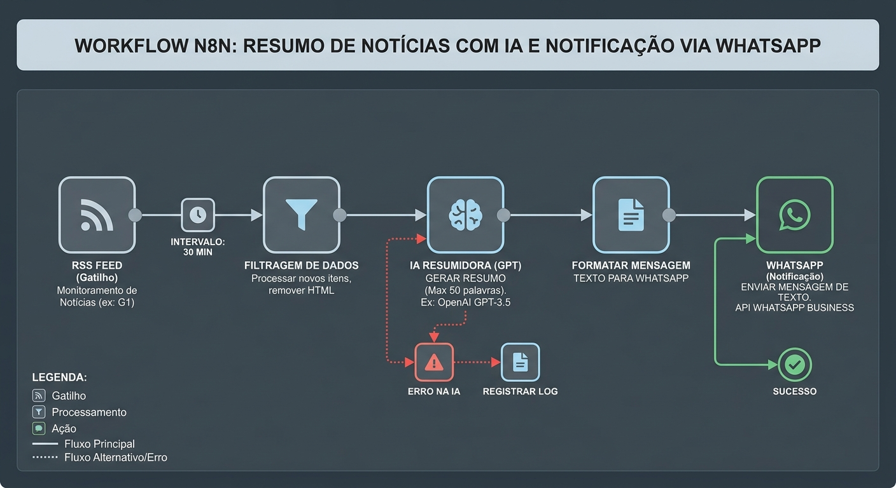

# 🎮 Resumo de Notícias (Games & Animes) via WhatsApp

> Automação N8N que coleta notícias diárias sobre games e animes via RSS, resume com IA (OpenAI) e envia os destaques direto no seu WhatsApp.



---

## 📋 Sobre o Projeto

Este projeto é uma automação criada no [n8n](https://n8n.io/) voltada para entusiastas de **games, e-sports e animes**. O workflow roda diariamente, busca as manchetes mais recentes de feeds RSS, filtra apenas notícias das últimas 24 horas, utiliza a **OpenAI (GPT-3.5)** para gerar um resumo descontraído e envia os **5 principais destaques** formatados diretamente no **WhatsApp**.

### ✨ Funcionalidades

- ⏰ **Agendamento automático** — executa uma vez por dia (configurável)
- 📡 **Coleta via RSS** — puxa notícias de portais de games/animes
- 🧹 **Filtragem inteligente** — descarta notícias repetidas e com mais de 24h
- 🤖 **Resumo por IA** — a OpenAI gera textos curtos, com emojis e linguagem descontraída
- 📱 **Envio via WhatsApp** — entrega o resumo direto no seu celular

---

## 🔄 Como Funciona

O workflow segue o fluxo abaixo, com 6 nós encadeados:

```
Agendamento Diário ➜ RSS Feed ➜ Filtro 24h (máx 5) ➜ IA Resumidora ➜ Formatar Mensagem ➜ WhatsApp
```

| # | Nó | Tipo | Descrição |
|---|-----|------|-----------|
| 1 | **Agendamento Diário** | `scheduleTrigger` | Dispara o fluxo a cada 24 horas |
| 2 | **Buscar Notícias (RSS Feed)** | `rssFeedRead` | Lê o feed RSS do portal configurado |
| 3 | **Filtrar Últimas 24h (Max 5)** | `code` (JavaScript) | Remove notícias antigas e limita a 5 itens |
| 4 | **IA Resumidora (OpenAI)** | `openAi` | Envia as manchetes ao GPT-3.5 para gerar um resumo formatado |
| 5 | **Formatar Mensagem** | `set` | Monta o texto final com título, conteúdo e assinatura |
| 6 | **Enviar Notificação (WhatsApp)** | `httpRequest` | Faz POST na API do WhatsApp para entregar a mensagem |

---

## 📁 Estrutura do Repositório

```
📦 desafio_criativo_N8N_usando_prompts
├── 📄 README.md                                         ← Este arquivo
├── 🖼️ fluxo.jpg                                         ← Diagrama visual do workflow
├── 📂 prompt/
│   └── 📄 comando_para_ia_dentro_do_fluxograma.txt      ← Prompt usado para gerar o workflow
└── 📂 src/
    └── 📄 workflow.json                                  ← Workflow N8N pronto para importar
```

---

## 🚀 Como Usar

### Pré-requisitos

- [n8n](https://n8n.io/) instalado (self-hosted ou cloud)
- Chave de API da [OpenAI](https://platform.openai.com/)
- API de envio de WhatsApp configurada (ex: [Evolution API](https://doc.evolution-api.com/), Z-API ou WhatsApp Business Cloud)

### Passo a Passo

1. **Importe o workflow** — Abra o n8n, vá em *Settings → Import Workflow* e carregue o arquivo [`src/workflow.json`](src/workflow.json)

2. **Configure o feed RSS** — No nó **Buscar Notícias (RSS Feed)**, substitua a URL pelo feed do portal desejado. Exemplo padrão:
   ```
   https://ge.globo.com/e-sports/rss/ge/
   ```

3. **Adicione a credencial da OpenAI** — No nó **IA Resumidora (OpenAI)**, conecte sua API Key da OpenAI

4. **Configure o WhatsApp** — No nó **Enviar Notificação (WhatsApp)**:
   - Substitua `https://SUA_API_WHATSAPP/send-message` pela URL da sua API
   - Substitua `SEU_TOKEN_AQUI` pelo seu token de autenticação
   - Substitua `5511999999999` pelo seu número de WhatsApp (com DDI + DDD)

5. **Ative o workflow** — Clique no botão **Active** no canto superior direito do n8n

---

## 💡 Personalização

| O que mudar | Onde | Como |
|-------------|------|------|
| Frequência de envio | Nó `Agendamento Diário` | Altere o intervalo de horas |
| Fonte de notícias | Nó `Buscar Notícias (RSS Feed)` | Troque a URL do feed RSS |
| Quantidade de notícias | Nó `Filtrar Últimas 24h (Max 5)` | Altere o valor em `.slice(0, 5)` |
| Tom do resumo | Nó `IA Resumidora (OpenAI)` | Edite o prompt de sistema |
| Modelo da IA | Nó `IA Resumidora (OpenAI)` | Troque `gpt-3.5-turbo` por outro modelo |

### 📡 Sugestões de Feeds RSS

| Portal | Feed RSS |
|--------|----------|
| ge.globo (E-sports) | `https://ge.globo.com/e-sports/rss/ge/` |
| IGN Brasil | `https://br.ign.com/feed.xml` |
| Crunchyroll News | `https://www.crunchyroll.com/pt-br/feed` |

---

## 🛠️ Tecnologias Utilizadas

- **[n8n](https://n8n.io/)** — Plataforma de automação de workflows
- **[OpenAI API](https://platform.openai.com/)** — Inteligência artificial para sumarização de texto (GPT-3.5-turbo)
- **WhatsApp API** — Envio de mensagens via Evolution API / Z-API / WhatsApp Business Cloud
- **RSS** — Protocolo de feeds para coleta de notícias

---

## 📜 Prompt Utilizado

O workflow foi concebido a partir do seguinte prompt de engenharia, disponível em [`prompt/comando_para_ia_dentro_do_fluxograma.txt`](prompt/comando_para_ia_dentro_do_fluxograma.txt):

> *"Atue como um especialista em N8N. Crie uma automação para buscar notícias diárias sobre o universo de jogos e animes em sites ou feeds RSS e enviar um resumo automatizado via WhatsApp."*

---

## 📝 Licença

Este projeto foi criado para fins educacionais e de uso pessoal. Sinta-se à vontade para usar, modificar e compartilhar.

---

<p align="center">
  Feito com 🤖 automação + ☕ café
</p>
